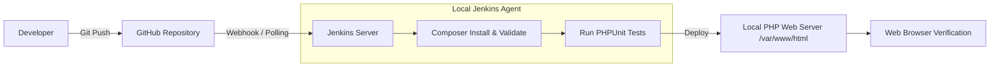
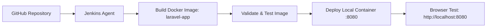
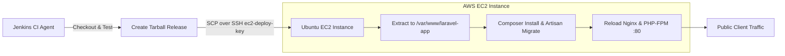
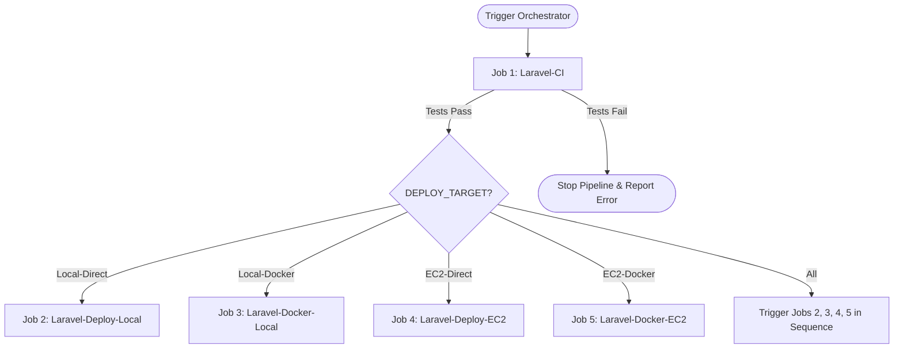

# DevOps Lab Manual: Jenkins CI/CD Pipeline for Laravel Deployment

This repository contains the complete implementation, configurations, source code, and Jenkins pipeline scripts for all tasks defined in the **DevOps Lab Manual: Jenkins CI/CD Pipeline for Laravel Deployment**.

---

## 📑 Table of Contents
1. [Overview & Project Structure](#-overview--project-structure)
2. [Architecture Diagrams](#-architecture-diagrams)
3. [Task 1: Direct Deployment on a Local Machine](#-task-1-direct-deployment-on-a-local-machine)
4. [Task 2: Docker Deployment on a Local Machine](#-task-2-docker-deployment-on-a-local-machine)
5. [Task 3: Direct Deployment on AWS EC2 (SSH + Nginx + PHP-FPM)](#-task-3-direct-deployment-on-aws-ec2)
6. [Task 4: Docker Deployment on AWS EC2 (Archive Transfer)](#-task-4-docker-deployment-on-aws-ec2)
7. [Additional Lab Task: Multi-Job Pipeline Suite (Jobs 1–6)](#-additional-lab-task-multi-job-pipeline-suite)
8. [Git & GitHub Setup Guide](#-git--github-setup-guide)
9. [Jenkins Dashboard Configuration Guide](#-jenkins-dashboard-configuration-guide)
10. [Troubleshooting & Common Pitfalls](#-troubleshooting--common-pitfalls)

---

## 📂 Overview & Project Structure

The project includes a production-ready Laravel application with automated unit and feature tests, Docker containerization, EC2 provisioning scripts, and declarative Jenkinsfiles for every deployment scenario:

```text
├── app/                        # Application Controllers, Models, Middleware, Kernel
│   ├── Http/Controllers/      # HomeController (Dashboard & /health endpoint)
├── bootstrap/                  # Laravel application bootstrap & cache
├── config/                     # Configuration files (app, database, logging, session)
├── database/                   # Migrations, seeders, factories (SQLite/MySQL support)
├── docker/
│   ├── apache.conf             # Apache VirtualHost with mod_rewrite enabled
│   └── entrypoint.sh           # Container entrypoint (key generation, cache, migrations)
├── jenkins/                    # Modular pipelines for Additional Lab Task (Jobs 1–6)
│   ├── Jenkinsfile.ci          # Job 1: Laravel-CI
│   ├── Jenkinsfile.deploy-local# Job 2: Laravel-Deploy-Local
│   ├── Jenkinsfile.docker-local# Job 3: Laravel-Docker-Local
│   ├── Jenkinsfile.deploy-ec2  # Job 4: Laravel-Deploy-EC2
│   ├── Jenkinsfile.docker-ec2  # Job 5: Laravel-Docker-EC2
│   └── Jenkinsfile.orchestrator# Job 6: Laravel-Full-Pipeline
├── nginx/
│   └── laravel.conf            # Nginx server block for EC2 direct deployment
├── public/                     # Public root (index.php, .htaccess)
├── resources/views/            # Blade templates (welcome.blade.php with live stats)
├── routes/                     # Web (/) & API (/health, /ping) routes
├── scripts/
│   ├── deploy-local.sh         # Local deployment helper script
│   ├── setup-ec2-direct.sh     # Ubuntu EC2 provisioning: Nginx, PHP-FPM, Composer, Git
│   ├── setup-ec2-docker.sh     # Ubuntu EC2 provisioning: Docker Engine
│   └── verify-deployment.sh    # Automated HTTP /health verification script
├── storage/                    # Framework storage and logs
├── tests/                      # PHPUnit Unit and Feature tests
├── .dockerignore               # Docker exclusions (.env, .git, vendor, node_modules)
├── .env.example                # Standard environment configuration template
├── .gitignore                  # Git exclusions
├── artisan                     # Laravel CLI runner
├── composer.json               # PHP dependencies & autoloader
├── docker-compose.yml          # Local multi-container orchestration
├── Dockerfile                  # Apache-based Laravel Dockerfile (Tasks 2 & 4)
├── Jenkinsfile                 # Default Task 1 pipeline
├── Jenkinsfile.task1           # Task 1 Pipeline (Direct Local)
├── Jenkinsfile.task2           # Task 2 Pipeline (Docker Local)
├── Jenkinsfile.task3           # Task 3 Pipeline (Direct AWS EC2)
├── Jenkinsfile.task4           # Task 4 Pipeline (Docker AWS EC2)
└── phpunit.xml                 # Test environment configuration (SQLite in-memory)
```

---

## 🏛 Architecture Diagrams

### Task 1: Direct Local Deployment


### Task 2: Docker Local Deployment


### Task 3: Direct Deployment on AWS EC2


### Task 4: Docker Deployment on AWS EC2 (Registry-Free)
```mermaid
flowchart LR
    Jenkins[Jenkins Agent] --> Build[docker build -t laravel-app]
    Build --> Save[docker save | gzip > laravel-image.tar.gz]
    Save -->|SCP via ec2-deploy-key| EC2[Ubuntu EC2 Instance]
    subgraph EC2_Docker [AWS EC2 Instance]
        EC2 --> Load[docker load < laravel-image.tar.gz]
        Load --> StopOld[docker rm -f laravel-app-container]
        StopOld --> RunNew[docker run -d -p 80:80 laravel-app:latest]
    end
    RunNew --> Users[Client Access :80]
```

### Orchestrator Workflow (Job 6)


---

## 🚀 Task 1: Direct Deployment on a Local Machine

### Scenario
A developer pushes updates to GitHub. Jenkins checks out the repository, installs Composer dependencies, runs tests, and deploys the application directly into the local web server directory.

### Procedure
1. **Prerequisites on Jenkins Host**:
   - PHP 8.1+ with extensions (`pdo`, `pdo_sqlite`, `mbstring`, `xml`, `curl`, `zip`)
   - Composer installed globally (`composer --version`)
   - Local web server (Nginx or Apache) pointing to `/var/www/html/laravel/public`
2. **Local Verification**:
   ```bash
   cp .env.example .env
   composer install
   php artisan key:generate
   php artisan test
   php artisan serve --port=8000
   ```
   Open `http://127.0.0.1:8000` to verify the application renders successfully.
3. **Pipeline Configuration**:
   - Script Path: `Jenkinsfile.task1` (or `Jenkinsfile`)
   - The pipeline checks out code, runs `composer install`, executes `./vendor/bin/phpunit`, syncs to `/var/www/html/laravel`, and verifies `http://localhost/health`.
4. **Verifying Continuous Deployment (Blade View Test)**:
   - Edit [resources/views/welcome.blade.php](file:///d:/Uni Stuff/Devops Assignmnent/resources/views/welcome.blade.php): change `"Pipeline Live (v1.0.0)"` to `"Pipeline Live (v1.1.0 - Updated via CI/CD)"`.
   - Commit and push to GitHub:
     ```bash
     git add resources/views/welcome.blade.php
     git commit -m "Update welcome blade view for Task 1 test"
     git push origin main
     ```
   - Jenkins detects the push, triggers the pipeline, and updates the local server automatically.
   - Refresh `http://localhost/` in your browser to verify the change.

---

## 🐳 Task 2: Docker Deployment on a Local Machine

### Scenario
Students package the Laravel application into a Docker container image with Apache and deploy it to a local Docker container instead of maintaining host PHP runtimes.

### Procedure
1. **Build and Test Docker Image Manually**:
   ```bash
   # Build Docker image
   docker build -t laravel-app:local .

   # Run container on port 8080
   docker run -d --name laravel-local-test -p 8080:80 laravel-app:local

   # Verify container health
   curl -f http://localhost:8080/health
   ```
   Open `http://localhost:8080` in your web browser.
2. **Clean Up Manual Test**:
   ```bash
   docker rm -f laravel-local-test
   ```
3. **Automate with Jenkins**:
   - Create a Jenkins Pipeline pointing to `Jenkinsfile.task2`.
   - The pipeline automatically builds `laravel-app:${BUILD_NUMBER}`, runs containerized tests, replaces any existing container, and validates the health endpoint.

---

## ☁️ Task 3: Direct Deployment on AWS EC2

### Scenario
Jenkins tests the Laravel application and deploys it to an Ubuntu EC2 instance over SSH without using Docker, served by Nginx and PHP-FPM.

### Step 1: AWS EC2 Launch & Security Group Configuration
1. Launch an Ubuntu 22.04 / 24.04 LTS instance (t2.micro / t3.micro).
2. Configure Security Group Inbound Rules:
   - **SSH (Port 22)**: Allow your Jenkins agent IP (or trusted IP range).
   - **HTTP (Port 80)**: Allow `0.0.0.0/0` (or required client traffic).
   - **HTTPS (Port 443)**: Allow `0.0.0.0/0` (if TLS/SSL is configured).

### Step 2: EC2 Instance Provisioning
Connect to your EC2 instance via SSH and run the automated provisioning script:
```bash
# Upload and run setup script
curl -fsSL https://raw.githubusercontent.com/YOUR_USER/YOUR_REPO/main/scripts/setup-ec2-direct.sh -o setup.sh
sudo bash setup.sh
```
This script automatically:
- Installs Nginx, PHP 8.2, PHP-FPM, Git, Composer, and all required PHP extensions.
- Creates `/var/www/laravel-app`.
- Configures `/etc/nginx/sites-available/laravel` with document root `/var/www/laravel-app/public`.
- Configures permissions and restarts Nginx and PHP-FPM.

### Step 3: Configure Jenkins SSH Credentials
1. In Jenkins, go to **Manage Jenkins** → **Credentials** → **System** → **Global credentials**.
2. Click **Add Credentials**:
   - **Kind**: SSH Username with private key
   - **ID**: `ec2-deploy-key`
   - **Username**: `ubuntu`
   - **Private Key**: Paste the content of your AWS `.pem` private key file.
3. Click **Create**.

### Step 4: Run the Pipeline
1. Create a Jenkins job pointing to `Jenkinsfile.task3`.
2. Set the parameter `EC2_HOST` to your EC2 instance's Public IP.
3. Click **Build with Parameters** → **Build**.
4. The pipeline packages the release, transfers it via SCP, extracts it on EC2, runs migrations and cache commands, reloads PHP-FPM and Nginx, and verifies `http://<EC2_PUBLIC_IP>/health`.

---

## 🚢 Task 4: Docker Deployment on AWS EC2

### Scenario
Jenkins builds the Apache-based Laravel Docker image on the Jenkins agent, exports it as a compressed archive (`.tar.gz`), transfers it to EC2 over SSH, loads the image, and launches the container—**no Docker registry required**.

### Step 1: Prepare the EC2 Instance for Docker
SSH into your EC2 instance and run:
```bash
# Upload and run Docker setup script
curl -fsSL https://raw.githubusercontent.com/YOUR_USER/YOUR_REPO/main/scripts/setup-ec2-docker.sh -o setup-docker.sh
sudo bash setup-docker.sh
```
Verify Docker runs without sudo:
```bash
newgrp docker
docker ps
```

### Step 2: Jenkins Pipeline Execution
1. Create a Jenkins Pipeline job pointing to `Jenkinsfile.task4`.
2. Parameters:
   - `EC2_HOST`: `<Your-EC2-Public-IP>`
   - `EC2_USER`: `ubuntu`
   - `SSH_CREDENTIALS_ID`: `ec2-deploy-key`
   - `HOST_PORT`: `80`
3. Click **Build with Parameters** → **Build**.
4. Pipeline execution stages:
   - **Build Docker Image**: Builds `laravel-app:latest` from `Dockerfile`.
   - **Compress & Archive**: Saves the image using `docker save | gzip > laravel-docker-image-${BUILD_NUMBER}.tar.gz`.
   - **Transfer Image to EC2**: Copies the archive directly to EC2 via SCP.
   - **Deploy Container**: Loads the image on EC2 via `docker load`, removes old containers, and runs the container bound to port 80.
   - **Verify**: Issues HTTP request to `http://<EC2_HOST>:80/health`.

---

## 🎛 Additional Lab Task: Multi-Job Pipeline Suite

This lab organizes CI/CD into 6 dedicated, modular Jenkins jobs:

| Job Name | Jenkinsfile Path | Purpose |
| :--- | :--- | :--- |
| **Job 1: `Laravel-CI`** | `jenkins/Jenkinsfile.ci` | Pulls code, validates composer, runs PHPUnit Unit & Feature tests. |
| **Job 2: `Laravel-Deploy-Local`** | `jenkins/Jenkinsfile.deploy-local` | Deploys validated code directly to local PHP/Apache web server. |
| **Job 3: `Laravel-Docker-Local`** | `jenkins/Jenkinsfile.docker-local` | Builds Docker image and runs local container on port 8080. |
| **Job 4: `Laravel-Deploy-EC2`** | `jenkins/Jenkinsfile.deploy-ec2` | Packages application and deploys to AWS EC2 via SSH and Nginx. |
| **Job 5: `Laravel-Docker-EC2`** | `jenkins/Jenkinsfile.docker-ec2` | Builds Docker image, transfers compressed tarball to EC2, runs container. |
| **Job 6: `Laravel-Full-Pipeline`** | `jenkins/Jenkinsfile.orchestrator` | Orchestrator job that runs Job 1 and conditionally triggers Jobs 2–5. |

### Creating Jobs in the Jenkins Dashboard:
1. Open Jenkins (`http://localhost:8080`).
2. Click **New Item**.
3. Enter the Job Name (e.g. `Laravel-CI`).
4. Select **Pipeline** and click **OK**.
5. Under **Pipeline**:
   - **Definition**: `Pipeline script from SCM`
   - **SCM**: `Git`
   - **Repository URL**: `https://github.com/YOUR_USER/YOUR_REPO.git`
   - **Branch Specifier**: `*/main`
   - **Script Path**: Set to the corresponding Jenkinsfile path (e.g., `jenkins/Jenkinsfile.ci`).
6. Click **Save**.
7. Repeat for Jobs 2 through 6.

---

## 🐙 Git & GitHub Setup Guide

Run these commands to push the project to your GitHub repository:

```bash
# 1. Initialize git repository
git init -b main

# 2. Stage all project files
git add .

# 3. Commit files
git commit -m "Initial commit: Complete Laravel DevOps CI/CD setup"

# 4. Link your remote GitHub repository
git remote add origin https://github.com/YOUR_GITHUB_USERNAME/YOUR_REPOSITORY_NAME.git

# 5. Push to GitHub
git push -u origin main
```

---

## 🛠 Troubleshooting & Common Pitfalls

| Issue | Root Cause | Solution |
| :--- | :--- | :--- |
| **Permission Denied (`storage/logs`)** | Web server (`www-data`) lacks write permission on storage directories. | Run `sudo chown -R www-data:www-data storage bootstrap/cache` and `sudo chmod -R 775 storage bootstrap/cache`. |
| **502 Bad Gateway on Nginx** | PHP-FPM socket path mismatch or PHP-FPM service stopped. | Verify socket exists at `/var/run/php/php8.2-fpm.sock`. Check service with `sudo systemctl status php8.2-fpm`. |
| **Docker Permission Denied on EC2** | `ubuntu` user is not in the `docker` group. | Run `sudo usermod -aG docker ubuntu` then reconnect SSH or run `newgrp docker`. |
| **SSH Host Key Verification Failed** | Jenkins agent cannot automatically accept EC2 host fingerprint. | Ensure pipeline includes `-o StrictHostKeyChecking=no -o UserKnownHostsFile=/dev/null` in SSH/SCP commands. |
| **`APP_KEY` Missing Error** | `.env` file does not contain a valid encryption key. | Run `php artisan key:generate --force`. The entrypoint and setup scripts automate this. |
| **Docker Port Conflict (`port is already allocated`)** | Previous container is still running on port 80/8080. | The pipelines automatically execute `docker rm -f <container_name> || true` prior to running the new container. |
